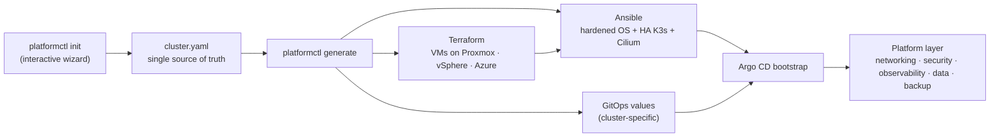

# k8s-platform-iac

**Production-style Kubernetes platform, from bare hypervisor to GitOps, in one repository.**
Terraform builds the machines, Ansible installs a hardened HA Kubernetes, and Argo CD delivers
an enterprise platform layer — all driven by a single `cluster.yaml` that an interactive CLI
helps you write.

> **Status: work in progress.** The design below is settled (see [ADRs](docs/adr/)); components
> are being ported from a working homelab cluster one at a time. See the [roadmap](#roadmap).

## How it works



1. **`platformctl init`** asks about your provider, network, sizing, domain and components, and
   writes [`cluster.yaml`](examples/cluster.yaml). Re-running it pre-fills current values.
2. **`platformctl generate`** renders Terraform variables, the Ansible inventory and the GitOps
   cluster values from that one file ([ADR 0001](docs/adr/0001-single-cluster-config.md)).
3. **`platformctl apply`** runs the phases in order. After the GitOps bootstrap, every change
   is a Git commit.

## Platform

| Layer | Components |
|---|---|
| Infrastructure | Terraform/OpenTofu modules with a common node contract ([ADR 0003](docs/adr/0003-provider-node-contract.md)) |
| Operating system | Ubuntu LTS, CIS-oriented hardening, auditd, unattended security updates |
| Kubernetes | K3s, 3 control planes with embedded etcd, kube-vip API VIP, secrets encryption at rest, audit logging |
| Networking | Cilium (eBPF, kube-proxy replacement), Gateway API, LB-IPAM, default-deny NetworkPolicies |
| Ingress & TLS | cert-manager (ACME DNS-01 or internal CA), external-dns |
| Identity | Keycloak SSO via OIDC for the Kubernetes API, Argo CD and Grafana |
| Secrets | External Secrets Operator + OpenBao; SOPS + age for bootstrap ([ADR 0002](docs/adr/0002-secrets-eso-openbao-sops.md)) |
| Policy & supply chain | Kyverno (enforce), Pod Security Admission, Trivy Operator, kube-bench |
| Observability | Prometheus, Alertmanager, Grafana, Loki, Grafana Alloy (optional: OpenTelemetry + Tempo) |
| Storage & data | Longhorn on dedicated disks, CloudNativePG operator with S3 backups |
| Backup & DR | Velero, etcd snapshots to S3, a tested [rebuild runbook](docs/runbooks/) |
| Operations | Argo CD (app-of-apps via ApplicationSet), Kured, system-upgrade-controller, Renovate |

## Providers

| Provider | Status |
|---|---|
| Proxmox VE | 🚧 in progress (ported from a working cluster) |
| VMware vSphere | 📝 planned — same node contract |
| Microsoft Azure | 📝 planned — same node contract, cloud LB and Key Vault |

## Repository layout

```
cli/            platformctl (Go)
terraform/      provider modules + per-provider environments
ansible/        roles: base, hardening, data_disk, k3s, cilium, argocd
gitops/         Argo CD bootstrap, platform components, per-cluster values
docs/           architecture, ADRs, runbooks
examples/       a fully commented cluster.yaml
```

## Roadmap

- [x] Design and ADRs
- [ ] `cluster.yaml` schema and `platformctl validate`
- [ ] Proxmox Terraform module and environment
- [ ] Ansible roles (OS hardening, HA K3s, Cilium, Argo CD bootstrap)
- [ ] GitOps platform layer (core components)
- [ ] `platformctl init / generate / secrets / apply`
- [ ] CI: formatting, validation, linting, policy and secret scanning
- [ ] Identity (Keycloak), secrets (ESO + OpenBao), supply-chain scanning
- [ ] vSphere and Azure modules

## License

[MIT](LICENSE)
