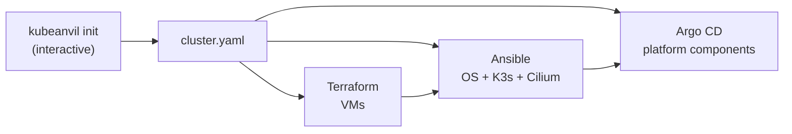

# kubeanvil

Build a highly available Kubernetes cluster on Proxmox VE and bootstrap it with GitOps, from
one configuration file. An interactive installer asks the questions; Terraform, Ansible and
Argo CD do the work.

> **Early development.** Nothing has been deployed end to end yet — see [status](#status).

## Try the CLI

Requires Go 1.24+. `init`, `validate` and `generate` only write files; `apply` creates VMs.

`init` asks four things: a cluster name, your Proxmox host, a size and whether the
recommended components suit you. It reads the rest from the host over SSH (read-only
`pvesh` and a ping sweep): storages, bridge and subnet, DNS, time zone, free memory, used
VMIDs and taken IP addresses. A review screen then shows the whole plan and lets you change
any part before `cluster.yaml` is written.

```bash
go run ./cmd/kubeanvil init      # questions → cluster.yaml (add --accessible for plain prompts)
go run ./cmd/kubeanvil validate  # catches overlapping IPs, etcd quorum, unsupported choices…
go run ./cmd/kubeanvil generate  # Terraform, Ansible and platform inputs under clusters/<name>/
go run ./cmd/kubeanvil apply     # VMs, OS, K3s, Cilium, Argo CD; asks before each phase
go run ./cmd/kubeanvil destroy   # deletes the VMs (type the cluster name to confirm)
```

`apply` also needs OpenTofu (or Terraform) and Ansible. It reads the Proxmox API token from
`PROXMOX_VE_API_TOKEN` or asks for it, and never stores it. Terraform state and the kubeconfig
stay in `clusters/<name>/`, which is git-ignored.

## How it works



`cluster.yaml` is the only file you edit (or let the wizard write). Everything else is
generated from it, so Terraform, Ansible and Argo CD never disagree about an IP address or a
domain. See [`examples/cluster.yaml`](examples/cluster.yaml) and
[ADR 0001](docs/adr/0001-single-cluster-config.md). The cluster's own values reach Argo CD
inside the root Application, so nothing about your network is committed to Git
([ADR 0007](docs/adr/0007-cluster-values-in-the-root-application.md)).

The planned entry point is a single command on the Proxmox host, in the spirit of the Proxmox
VE Community Scripts ([ADR 0005](docs/adr/0005-one-line-installer-and-bastion.md)):

```bash
bash -c "$(curl -fsSL https://raw.githubusercontent.com/liosmarf/kubeanvil/v0.1.0/install.sh)"
```

## Status

| Part | State |
|---|---|
| Proxmox VM module and environment ([`terraform/`](terraform/)) | ✅ validated with Terraform and OpenTofu |
| Ansible: OS hardening, HA K3s, Cilium, Argo CD bootstrap ([`ansible/`](ansible/)) | ✅ ported; passes ansible-lint (production) · 🚧 end-to-end run |
| [Component catalog](gitops/platform/catalog.yaml): 12 categories, the 2–3 most used options each, pinned versions | ✅ |
| GitOps platform chart: one Argo CD Application per selected component ([`gitops/`](gitops/)) | ✅ every component renders and validates ([`scripts/check-gitops.sh`](scripts/check-gitops.sh)) |
| `kubeanvil` CLI ([`cmd/`](cmd/), [`internal/`](internal/)): `validate`, `generate` | ✅ tested (`go test ./...`) |
| `kubeanvil init` wizard: Proxmox discovery, size presets, component choice, review | ✅ tested against a real Proxmox host and in a pty |
| `kubeanvil apply` / `destroy`: Terraform → Ansible → Argo CD bootstrap → kubeconfig | ✅ built · 🚧 end-to-end run |
| One-line installer with Proxmox discovery | 🚧 |
| vSphere and Azure modules ([ADR 0003](docs/adr/0003-provider-node-contract.md)) | planned |

## Design decisions

The [ADRs](docs/adr/) record what was decided and why: a single config file, secrets with
External Secrets + OpenBao (SOPS for bootstrap), a node contract shared by all providers, a Go
CLI, the installer, the component catalog, and per-cluster values kept out of Git.

## License

[MIT](LICENSE)
